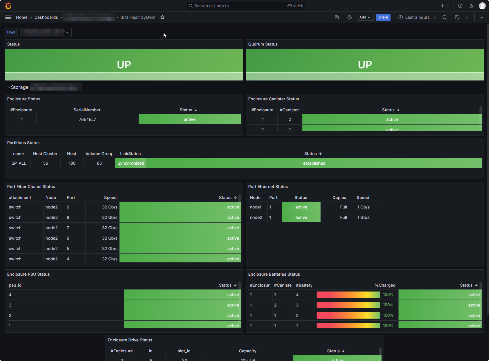

# ibmfs_exporter

## Overview

see [more screenshots](./screenshots/details.md)

## Description

This contribution to httpapi_exporter is an adaptation of the formulae from the IBM "standard" [spectrum-virtualize-exporter](https://github.com/IBM/spectrum-virtualize-exporter). Metrics have been constructed for my company needs and a look at IBM exporter.

As usual, if you don't find what you're looking for or have different needs from those offered by the publisher... do it yourself by customizing the collection configuration!

## Available Collectors

The IBM FlashSystem exporter includes the following collectors:

- `ibmfs_array.collector.yml`
- `ibmfs_drive.collector.yml`
- `ibmfs_enclosure.collector.yml`
- `ibmfs_enclosurebattery.collector.yml`
- `ibmfs_enclosurecanister.collector.yml`
- `ibmfs_enclosurepsu.collector.yml`
- `ibmfs_partition.collector.yml`
- `ibmfs_portethernet.collector.yml`
- `ibmfs_portfc.collector.yml`
- `ibmfs_quorum.collector.yml`
- `ibmfs_system.collector.yml`
- `ibmfs_systemstats.collector.yml`

Each collector exposes the following metrics. Metric names are prefixed with `ibmfs_` followed by the collector prefix defined in each YAML file.

### IBM FlashSystem Collectors and Metrics

| Collector | Metric Name | Description | Type |
|-----------|-------------|-------------|------|
| Ibmfs Array | **ibmfs_array_status** | quorum status 0 Offline / 1 Online / 2 Degraded / 3 Unknown | gauge |
| Ibmfs Array | **ibmfs_array_total_capacity_bytes** | capacity in bytes of the array labeled by name and group_name | gauge |
| Ibmfs Drive | **ibmfs_drive_status** | drive status 0 Offline / 1 Online / 2 Degraded / 3 Unknown | gauge |
| Ibmfs Drive | **ibmfs_drive_total_capacity_bytes** | capacity in bytes of the array | gauge |
| Ibmfs Drive | **ibmfs_drive_physical_used_bytes** | capacity in bytes of the array | gauge |
| Ibmfs Drive | **ibmfs_drive_effective_used_bytes** | capacity in bytes of the array | gauge |
| Ibmfs Enclosure | **ibmfs_enclosure_status** | enclosure status 0 Offline / 1 Online / 2 Degraded / 3 Unknown | gauge |
| Ibmfs Enclosurebattery | **ibmfs_enclosurebattery_status** | enclosure batteries status 0 Offline / 1 Online / 2 Degraded / 3 Unknown | gauge |
| Ibmfs Enclosurebattery | **ibmfs_enclosurebattery_charged_percent** | enclosure batteries charged percent | gauge |
| Ibmfs Enclosurecanister | **ibmfs_enclosurecanister_status** | enclosure canister status 0 Offline / 1 Online / 2 Degraded / 3 Unknown | gauge |
| Ibmfs Enclosurepsu | **ibmfs_enclosurepsu_status** | enclosure power supply status 0 Offline / 1 Online / 2 Degraded / 3 Unknown | gauge |
| Ibmfs Partition | **ibmfs_partition_ha_status** | partition ha status null or empty: 0 - established: 1 - establishing: 2 - suspended: 3 - encountered_a_problem: 4 | gauge |
| Ibmfs Partition | **ibmfs_partition_link_status** | partition link status 0 Offline / 1 synchronized / 2 ?? / 3 Unknown | gauge |
| Ibmfs Partition | **ibmfs_partition_host_count** | partition hosts count | gauge |
| Ibmfs Partition | **ibmfs_partition_volume_group_count** | partition volume group count | gauge |
| Ibmfs Partition | **ibmfs_partition_host_cluster_count** | partition host cluster count | gauge |
| Ibmfs Portethernet | **ibmfs_portethernet_status** | interface status 0 inactive / 1 active / 2 unknown | gauge |
| Ibmfs Portethernet | **ibmfs_portethernet_speed_bps** | interface speed in bits per second | gauge |
| Ibmfs Portethernet | **ibmfs_portethernet_duplex** | interface duplex status 0 unknown / 1 Half / 2 Full | gauge |
| Ibmfs Portfc | **ibmfs_portfc_status** | portFC status 0 inactive_configured / 1 active / 2 inactive_unconfigured / 3 unknown | gauge |
| Ibmfs Portfc | **ibmfs_portfc_speed_bps** | interface speed in bits per second | gauge |
| Ibmfs Quorum | **ibmfs_quorum_status** | quorum status 0 Offline / 1 Online / 2 Degraded / 3 Unknown | gauge |
| Ibmfs System | **ibmfs_system_total_mdisk_capacity_bytes** | The sum of mdiskgrp capacity plus the capacity of all unmanaged MDisks in bytes | gauge |
| Ibmfs System | **ibmfs_system_space_in_mdisk_grps_bytes** | The sum of mdiskgrp capacity | gauge |
| Ibmfs System | **ibmfs_system_space_allocated_to_vdisks_bytes** | The sum of mdiskgrp real_capacity | gauge |
| Ibmfs System | **ibmfs_system_total_free_space_bytes** | The sum of mdiskgrp free_capacity | gauge |
| Ibmfs System | **ibmfs_system_total_vdiskcopy_capacity_bytes** | The total virtual capacity of all volume copies in the cluster | gauge |
| Ibmfs System | **ibmfs_system_total_used_capacity_bytes** | The sum of mdiskgrp used_capacity | gauge |
| Ibmfs System | **ibmfs_system_total_overallocation_percent** | The total_vdiskcopy_capacity as a percentage of total_mdisk_capacity. If total_mdisk_capacity is zero, then total_overallocation should display 100 | gauge |
| Ibmfs System | **ibmfs_system_total_vdisk_capacity_bytes** | The total virtual capacity of volumes in the cluster | gauge |
| Ibmfs System | **ibmfs_system_total_allocated_extent_capacity_bytes** | The total size of all extents that are allocated to VDisks or otherwise in use by the system | gauge |
| Ibmfs System | **ibmfs_system_compression_virtual_capacity_bytes** | The total virtual capacity for all compressed volume copies in non-data reduction pools. Compressed volumes that are in data reduction pools do not count towards this value. This value is in unsigned decimal format | gauge |
| Ibmfs System | **ibmfs_system_compression_compressed_capacity_bytes** | The total used capacity for all compressed volume copies in non-data reduction pools | gauge |
| Ibmfs System | **ibmfs_system_compression_uncompressed_capacity_bytes** | The total uncompressed used capacity for all compressed volume copies in non-data reduction pools | gauge |
| Ibmfs System | **ibmfs_system_total_drive_raw_capacity_bytes** | The total known capacity of all discovered drives | gauge |
| Ibmfs System | **ibmfs_system_tier0_flash_compressed_data_used_bytes** | The capacity of compressed data used on the flash tier 0 storage tier | gauge |
| Ibmfs System | **ibmfs_system_tier1_flash_compressed_data_used_bytes** | The capacity of compressed data used on the flash tier 1 storage tier | gauge |
| Ibmfs System | **ibmfs_system_tier_enterprise_compressed_data_used_bytes** | The capacity of compressed data that is used on the tier 2 enterprise storage tier | gauge |
| Ibmfs System | **ibmfs_system_tier_nearline_compressed_data_used_bytes** | The capacity of compressed data that is used on the tier 3 nearline storage tier | gauge |
| Ibmfs System | **ibmfs_system_total_reclaimable_capacity_bytes** | The unused free capacity that will be available after data is reduced | gauge |
| Ibmfs System | **ibmfs_system_physical_capacity_bytes** | The total physical capacity of all fully allocated and thin-provisioned storage that is managed by the storage system | gauge |
| Ibmfs System | **ibmfs_system_physical_free_capacity_bytes** | The total free physical capacity of all fully allocated and thin-provisioned storage that is managed by the storage system | gauge |
| Ibmfs System | **ibmfs_system_used_capacity_before_reduction_bytes** | The total amount of data that is written to thin-provisioned and compressed volume copies that are in data reduction storage pools - before data reduction occurs | gauge |
| Ibmfs System | **ibmfs_system_used_capacity_after_reduction_bytes** | The total amount of capacity that is used for thin-provisioned and compressed volume copies in the storage pool after data reduction occurs | gauge |
| Ibmfs System | **ibmfs_system_overhead_capacity_bytes** | The overhead capacity consumption in all storage pools that is not attributed to data | gauge |
| Ibmfs System | **ibmfs_system_deduplication_capacity_saving_bytes** | The total amount of used capacity that is saved by data deduplication. This saving is before any compression | gauge |
| Ibmfs System | **ibmfs_system_tier_capacity** | The total MDisk storage in the tier | gauge |
| Ibmfs System | **ibmfs_system_tier_free_capacity_bytes** | The amount of MDisk storage in the tier that is unused | gauge |
| Ibmfs System | **ibmfs_system_physical_capacity_usage_percent** | The physical capacity utilization | gauge |
| Ibmfs System | **ibmfs_system_volume_capacity_usage** | The volume capacity utilization | gauge |
| Ibmfs System | **ibmfs_system_mdiskgrp_capacity_usage** | The mdiskgrp capacity utilization | gauge |
| Ibmfs Systemstats | **ibmfs_system_compression_cpu_pc** | The percentage of allocated CPU capacity that is used for compression | gauge |
| Ibmfs Systemstats | **ibmfs_system_cpu_pc** | The percentage of allocated CPU capacity that is used for the system | gauge |
| Ibmfs Systemstats | **ibmfs_system_fc_mb** | The total number of megabytes transferred per second for Fibre Channel traffic on the system. This value includes host I/O and any bandwidth that is used for communication within the system | gauge |
| Ibmfs Systemstats | **ibmfs_system_fc_io** | The total input/output operations that are transferred per second for Fibre Channel traffic on the system. This value includes host I/O and any bandwidth that is used for communication within the system | gauge |
| Ibmfs Systemstats | **ibmfs_system_sas_mb** | The total number of megabytes transferred per second for serial-attached SCSI traffic on the system | gauge |
| Ibmfs Systemstats | **ibmfs_system_sas_io** | The total I/O operations that are transferred per second for SAS traffic on the system | gauge |
| Ibmfs Systemstats | **ibmfs_system_iscsi_mb** | The total number of megabytes transferred per second for iSCSI traffic on the system | gauge |
| Ibmfs Systemstats | **ibmfs_system_iscsi_io** | The total I/O operations that are transferred per second for iSCSI traffic on the system | gauge |
| Ibmfs Systemstats | **ibmfs_system_write_cache_pc** | The percentage of the write cache usage for the node | gauge |
| Ibmfs Systemstats | **ibmfs_system_total_cache_pc** | The total percentage for both the write and read cache usage for the node | gauge |
| Ibmfs Systemstats | **ibmfs_system_vdisk_mb** | The average number of megabytes transferred per second for read and write operations to volumes during the sample period | gauge |
| Ibmfs Systemstats | **ibmfs_system_vdisk_io** | The average number of I/O operations that are transferred per second for read and write operations to volumes during the sample period | gauge |
| Ibmfs Systemstats | **ibmfs_system_vdisk_ms** | The average amount of time in milliseconds that the system takes to respond to read and write requests to volumes over the sample period | gauge |
| Ibmfs Systemstats | **ibmfs_system_mdisk_mb** | The average number of megabytes transferred per second for read and write operations to MDisks during the sample period | gauge |
| Ibmfs Systemstats | **ibmfs_system_mdisk_io** | The average number of I/O operations that are transferred per second for read and write operations to MDisks during the sample period | gauge |
| Ibmfs Systemstats | **ibmfs_system_mdisk_ms** | The average amount of time in milliseconds that the system takes to respond to read and write requests to MDisks over the sample period | gauge |
| Ibmfs Systemstats | **ibmfs_system_drive_mb** | The average number of megabytes transferred per second for read and write operations to drives during the sample period | gauge |
| Ibmfs Systemstats | **ibmfs_system_drive_io** | The average number of I/O operations that are transferred per second for read and write operations to drives during the sample period | gauge |
| Ibmfs Systemstats | **ibmfs_system_drive_ms** | The average amount of time in milliseconds that the system takes to respond to read and write requests to drives over the sample period | gauge |
| Ibmfs Systemstats | **ibmfs_system_vdisk_r_mb** | The average number of megabytes transferred per second for read operations to volumes during the sample period | gauge |
| Ibmfs Systemstats | **ibmfs_system_vdisk_r_io** | The average number of I/O operations that are transferred per second for read operations to volumes during the sample period | gauge |
| Ibmfs Systemstats | **ibmfs_system_vdisk_r_ms** | The average amount of time in milliseconds that the system takes to respond to read requests to volumes over the sample period | gauge |
| Ibmfs Systemstats | **ibmfs_system_vdisk_w_mb** | The average number of megabytes transferred per second for write operations to volumes during the sample period | gauge |
| Ibmfs Systemstats | **ibmfs_system_vdisk_w_io** | The average number of I/O operations that are transferred per second for write operations to volumes during the sample period | gauge |
| Ibmfs Systemstats | **ibmfs_system_vdisk_w_ms** | The average amount of time in milliseconds that the system takes to respond to write requests to volumes over the sample period | gauge |
| Ibmfs Systemstats | **ibmfs_system_mdisk_r_mb** | The average number of megabytes transferred per second for read operations to MDisks during the sample period | gauge |
| Ibmfs Systemstats | **ibmfs_system_mdisk_r_io** | The average number of I/O operations that are transferred per second for read operations to MDisks during the sample period | gauge |
| Ibmfs Systemstats | **ibmfs_system_mdisk_r_ms** | The average amount of time in milliseconds that the system takes to respond to read requests to MDisks over the sample period | gauge |
| Ibmfs Systemstats | **ibmfs_system_mdisk_w_mb** | The average number of megabytes transferred per second for write operations to MDisks during the sample period | gauge |
| Ibmfs Systemstats | **ibmfs_system_mdisk_w_io** | The average number of I/O operations that are transferred per second for write operations to MDisks during the sample period | gauge |
| Ibmfs Systemstats | **ibmfs_system_mdisk_w_ms** | The average amount of time in milliseconds that the system takes to respond to write requests to MDisks over the sample period | gauge |
| Ibmfs Systemstats | **ibmfs_system_drive_r_mb** | The average number of megabytes transferred per second for read operations to drives during the sample period | gauge |
| Ibmfs Systemstats | **ibmfs_system_drive_r_io** | The average number of I/O operations that are transferred per second for read operations to drives during the sample period | gauge |
| Ibmfs Systemstats | **ibmfs_system_drive_r_ms** | The average amount of time in milliseconds that the system takes to respond to read requests to drives over the sample period | gauge |
| Ibmfs Systemstats | **ibmfs_system_drive_w_mb** | The average number of megabytes transferred per second for write operations to drives during the sample period | gauge |
| Ibmfs Systemstats | **ibmfs_system_drive_w_io** | The average number of I/O operations that are transferred per second for write operations to drives during the sample period | gauge |
| Ibmfs Systemstats | **ibmfs_system_drive_w_ms** | The average amount of time in milliseconds that the system takes to respond to write requests to drives over the sample period | gauge |
| Ibmfs Systemstats | **ibmfs_system_power_w** | The power that is consumed in watts | gauge |
| Ibmfs Systemstats | **ibmfs_system_temp_c** | The ambient temperature in Celsius | gauge |
| Ibmfs Systemstats | **ibmfs_system_temp_f** | The ambient temperature in Fahrenheit | gauge |
| Ibmfs Systemstats | **ibmfs_system_iplink_mb** | The average number of megabytes requested to be transferred per second over the IP partnership link | gauge |
| Ibmfs Systemstats | **ibmfs_system_iplink_io** | The total input/output operations that are transferred per second for IP partnership traffic on the system | gauge |
| Ibmfs Systemstats | **ibmfs_system_iplink_comp_mb** | The average number of compressed megabytes transferred per second over the IP Replication link during the sample period | gauge |
| Ibmfs Systemstats | **ibmfs_system_cloud_up_mb** | The average number of megabytes transferred per second for upload operations to a cloud account | gauge |
| Ibmfs Systemstats | **ibmfs_system_cloud_up_ms** | The average amount of time in milliseconds it takes for the system to respond to upload requests to a cloud account | gauge |
| Ibmfs Systemstats | **ibmfs_system_cloud_down_mb** | The average number of Mbps for download operations to a cloud account | gauge |
| Ibmfs Systemstats | **ibmfs_system_cloud_down_ms** | The average amount of time in milliseconds it takes for the system to respond to download requests to a cloud account | gauge |
| Ibmfs Systemstats | **ibmfs_system_iser_mb** | The total number of megabytes transferred per second for iSER traffic on the system | gauge |
| Ibmfs Systemstats | **ibmfs_system_iser_io** | The total I/O operations that are transferred per second for iSER traffic on the system | gauge |
